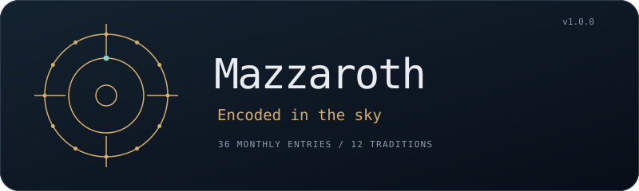
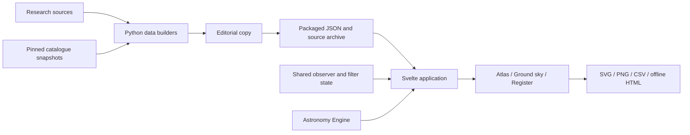

<p align="center">
  
</p>

<h1 align="center">Mazzaroth</h1>

<p align="center">
  <strong>Encoded in the sky.</strong><br>
  A research atlas of Astrolabe B's monthly assignments and modern star positions.
</p>

<p align="center">
  <a href="#installation">Installation</a> •
  <a href="#usage">Usage</a> •
  <a href="#features">Features</a> •
  <a href="#how-it-works">How It Works</a> •
  <a href="#development">Development</a>
</p>

## What is Mazzaroth?

Astrolabe B preserves a Babylonian list assigning three celestial names to each
of the twelve months, one in each of the paths of Enlil, Anu and Ea. Mazzaroth
compares those 36 assignments with measured star positions and lets you explore
the sky for a selected place, epoch and reading time.

The atlas includes twelve constellation traditions and textual comparisons,
with identification evidence, catalogue provenance and source credits. It runs
in the browser from packaged resources and can be exported as a self-contained
HTML file. Version **1.0.0** uses Svelte, TypeScript, D3 and Astronomy Engine.

## Features

- **Atlas** — A calendar wheel over the catalogue sky, with independent layers,
  full-wheel zoom and pan, reference stars, coordinate grid and an equinox marker.
- **Ground sky** — A perspective view from the observer, with camera controls,
  twelve selectable traditions, figure finding and a geometric horizon.
- **Celestial register** — Search the 36 entries by name, month and path; inspect
  identifications and their evidence, and download the filtered table as CSV.
- **Pole and epoch controls** — Celestial pole, Polaris, Thuban and Kochab presets;
  Custom enables manual year and BCE/CE entry. The sky accounts for catalogue
  proper motion and precession/nutation within the supported date range.
- **Shared state** — Filters, selections and observer settings survive page
  navigation; each sky view retains its camera or zoom position.
- **Portable exports** — SVG charts with a dated pole label, PNG ground views,
  research JSON, source archives and a standalone offline atlas.

## Installation

### Build from source

You'll need Node.js **22.12 or newer** and npm. Python is needed only to rebuild
or validate the research datasets; ordinary application builds use the packaged
copies. No API key or backend service is required.

From the repository root:

```bash
npm ci
npm run dev
```

Open the local URL printed by Vite. For a production build:

```bash
npm run build
npm run preview
```

The build creates `dist/` for static hosting and
`dist/mazzaroth-wheel.html` for direct use from disk. The offline edition embeds
its code, datasets, font, favicon and downloadable license/source materials.

## Usage

### Explore the atlas

Choose **Atlas** and use the controls below the wheel to show or hide the
calendar and catalogue layers, adjust orientation and opacity, or toggle
labels and sky details. Scroll over the wheel to zoom and drag to pan. Select
a calendar entry or star to inspect its details.

### Set the observer and epoch

Open **Observer, epoch & reading time**. Choose a pole preset, or select
**Custom** to enter a year and BCE/CE. Set the brightness cutoff, then enable
the observer readout to choose location, nominal calendar day and morning or
evening. Reading time & calibration also supports a timing star at culmination.

The supported observer range is **3000 BCE–3000 CE**. Pole-star presets use their
best-fit dates within that interval and treat the chosen star as the assumed
axis. Model details and residual offsets appear in the readout and Sources &
method. The spring equinox is the seasonal reference; stars move relative to
it as the epoch changes.

### Look around the ground sky

Choose **Ground sky**. Drag to look around, scroll to change the field of view,
or use the direction buttons and keyboard controls. Select a tradition and use
**Find a figure** to centre it. Below-horizon stars remain available, dimmed for
reference. Figure lines remain visible when the brightness cutoff hides stars.

### Use the register and exports

Choose **Register** to search and filter entries without the observer controls.
The detail panel links each identification to its sources. Use **Download CSV**
for the filtered table; the sky pages offer SVG or PNG exports. Dataset and
offline downloads are available in the footer, with licenses in Sources & method.

## How It Works



1. Local builders join the historical entries to catalogue reference stars and
   convert attributed constellation source files into the application datasets.
2. The app loads those packaged resources and shares filter and selection state
   across three pages.
3. Astronomy Engine supplies solar events and coordinate transforms; the
   observer wrapper applies proper motion and the selected physical or assumed
   axis. A typed numeric calendar adapter handles date input and labels.
4. D3 renders the Atlas SVG and a Canvas module renders Ground sky. Exports use
   the displayed data and geometry.

## Technical Details

### Project layout

| Path | Responsibility |
| --- | --- |
| [`src/App.svelte`](src/App.svelte) | Shared shell and hash-based page navigation |
| [`src/lib/pages/`](src/lib/pages/) | Atlas, Ground sky and Register components |
| [`src/lib/components/`](src/lib/components/) | Reusable controls, detail panel and sources dialog |
| [`src/lib/state.svelte.ts`](src/lib/state.svelte.ts) | Shared typed application state |
| [`src/lib/astronomy/`](src/lib/astronomy/) | Numeric calendar and time conversion |
| [`src/lib/legacy/`](src/lib/legacy/) | Adapted prototype renderer and its typed boundary |
| [`public/runtime/`](public/runtime/) | Observer, Canvas renderer, generated calendar and vendored libraries |
| [`public/resources/`](public/resources/) | Packaged datasets, source ZIP and coordinate CSV |
| [`research/`](research/) | Historical records, source texts, evidence and pinned skyculture inputs |
| [`catalogue/`](catalogue/) | Compressed catalogue snapshots, provenance and refresh tools |
| [`scripts/`](scripts/) | Data, runtime, license and offline builders; validation entry points |
| [`tests/`](tests/) | Calendar, geometry and browser checks |
| [`docs/`](docs/) | Architecture/model notes and source provenance |

### Data and reproducibility

The repository includes the inputs needed to rebuild its datasets offline with
Python **3.10 or newer**, using the standard library:

```bash
npm run resources:build
npm run resources:check
```

The builders write intermediate output to ignored `.data/`; the sync step applies
editorial copy and packages the results under `public/resources/`. The check
command verifies source snapshots, scientific data, source fidelity,
reproducibility and agreement with the packaged resources.

The compressed catalogue snapshots preserve their original bytes and have
checksums in [`catalogue/snapshots.json`](catalogue/snapshots.json). Upstream
catalogue refresh is a separate, optional operation that requires network access
and SciPy. See [`catalogue/README.md`](catalogue/README.md).

Dates displayed by the observer are proleptic Gregorian model dates. The nominal
calendar uses twelve 30-day months mapped to 365 elapsed days. Brightness combines
Gaia G and Johnson V measurements. Historical identifications, measured stars
and representative group positions remain distinct in the records. See
[`research/methodology.md`](research/methodology.md) and
[`docs/architecture.md`](docs/architecture.md) for the calculation conventions.

## Development

```bash
# Type-check Svelte and TypeScript
npm run check

# Build the static and offline editions
npm run build

# Calendar and numerical geometry checks
npm run test:time
npm run test:geometry

# Install Chromium once, then run production browser checks
npx playwright install chromium
npm run test:browser
```

The renderer's internal JavaScript is being retained behind a typed adapter
while the surrounding UI moves into Svelte. The numerical tests exercise the
actual runtime modules; browser checks cover navigation, shared state, controls,
epoch changes, equinox reference, exports, mobile layout and offline operation.

For preview access through a named host, copy `.env.example` to `.env.local` and
set `MAZZAROTH_PREVIEW_HOSTS` to a comma-separated allowlist. Then bind
`npm run preview` to the appropriate interface with `-- --host <address>`.
Local hostnames and environment files are not committed.

## Troubleshooting

| Problem | What to check |
| --- | --- |
| A resource fails to load | Serve `dist/` over HTTP, or use the self-contained `mazzaroth-wheel.html` file. |
| The year field is locked | Select **Custom**; preset dates are calculated by the model. |
| Ground sky is unavailable | Check the observer readout. Some dates and latitudes have no crossing at the chosen Sun altitude. |
| A named host is blocked | Add that hostname to `MAZZAROTH_PREVIEW_HOSTS` in `.env.local` and restart preview. |
| A dataset check reports differences | Rebuild with `npm run resources:build`, inspect the changes, then rerun the check. |
| Catalogue checksums fail | Inspect the changed snapshot; its recorded digest identifies the pinned source data. |

## Contributing

Include reproduction steps and screenshots for interface issues. For changes to
calculations or data, include the source evidence and relevant validation results.
Preserve source identifiers, attribution, licenses and unresolved identifications.

## License

Original application code uses the
[PolyForm Noncommercial License 1.0.0](LICENSE).
Third-party code, fonts, catalogues and constellation data retain their existing
terms; see [Third-party notices](THIRD_PARTY_NOTICES.md).

Required Notice: Copyright (c) 2026 Martin Bukowski <martin@bmds.us>

## Author

[Martin Bukowski](mailto:martin@bmds.us) · **Version 1.0.0**
